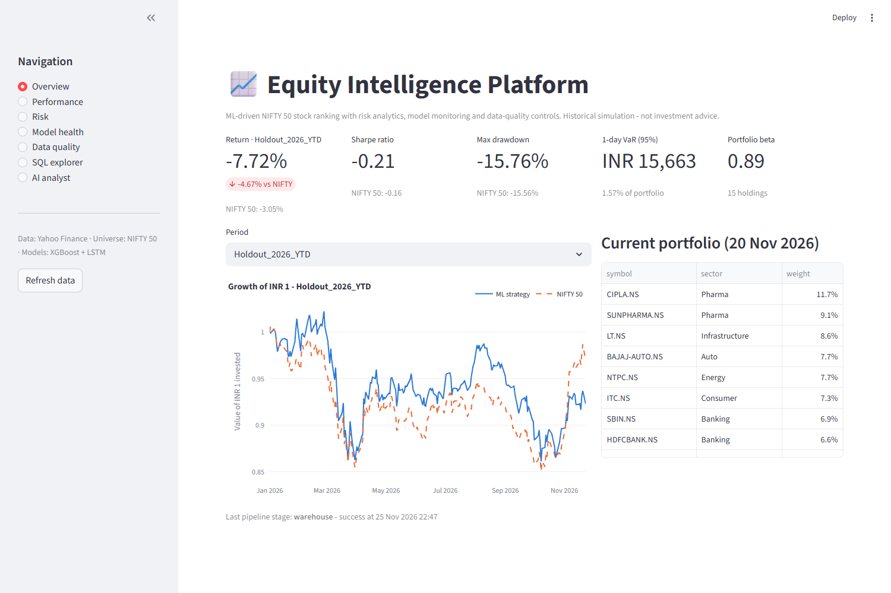
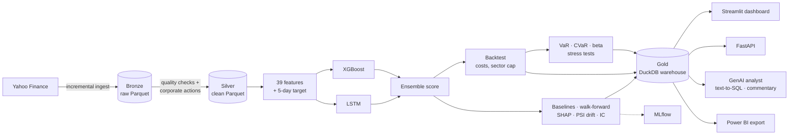
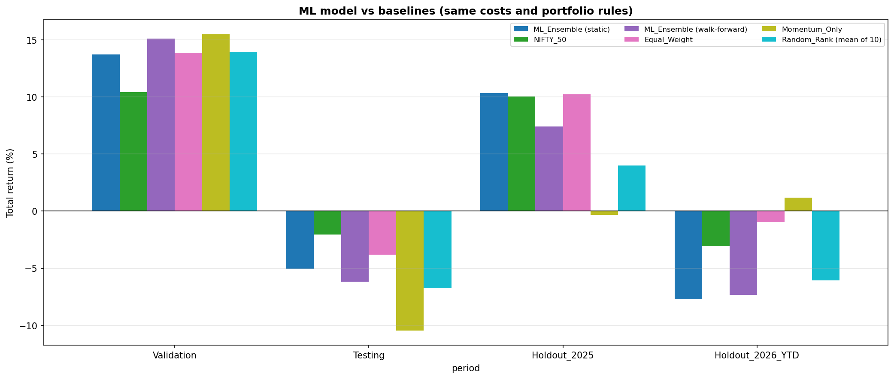
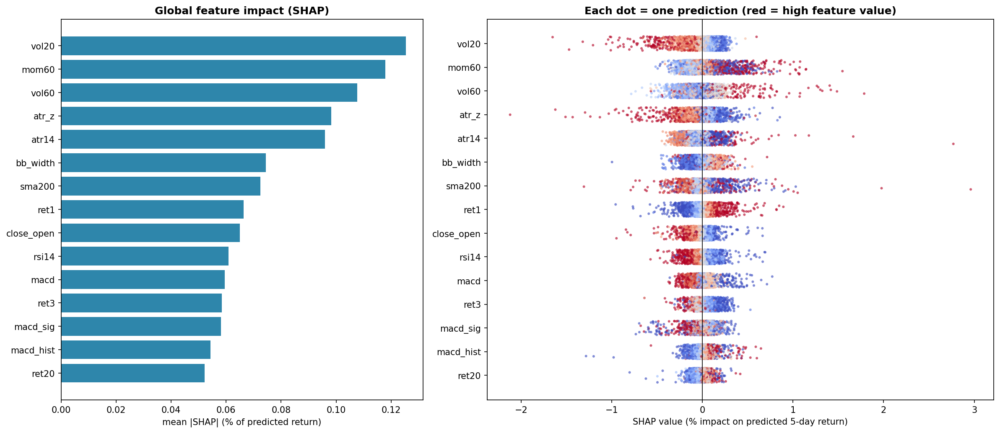
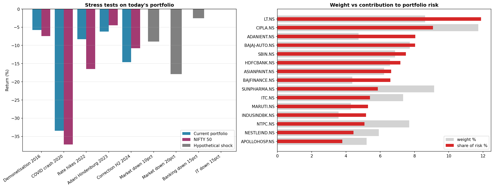
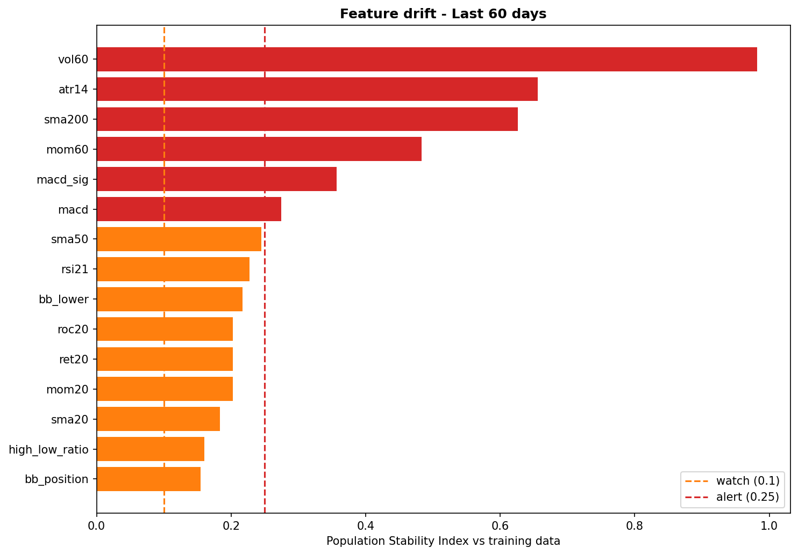

# Equity Intelligence Platform

**An end-to-end data, machine-learning, risk-analytics and GenAI platform for NIFTY 50 equities.**

It ingests 16 years of daily market data into a layered data pipeline with automated quality
checks, ranks stocks with an XGBoost + LSTM ensemble, backtests a cost-aware portfolio, measures
its market risk the way a bank risk team would (VaR, CVaR, beta, stress tests), monitors the model
for drift, explains every prediction with SHAP, and lets users query the results in plain English.



> Historical simulation for research and education - not investment advice.

---

## What the platform does

| Area | What is built | Where |
|---|---|---|
| **Data engineering** | Incremental ingestion of 51 stocks + NIFTY 50 (Yahoo Finance) into a bronze → silver → gold layout: raw Parquet, validated Parquet, DuckDB warehouse (star schema, 14 tables, 7 BI views) | `equity_intel/data/` |
| **Data quality** | pandera schema checks + market checks (calendar gaps, stale tickers, extreme moves, flat prices) → PASS / WARN / FAIL per ticker; corporate-actions master for unadjusted splits / demergers | `equity_intel/data/quality.py`, `config/corporate_actions.yaml` |
| **SQL & BI** | 12 business questions answered in SQL, reusable views, Parquet export + data-model guide for Power BI | `sql/`, `docs/powerbi_guide.md` |
| **Machine learning** | 39 engineered features, XGBoost (cross-sectional) + 2-layer LSTM (90-day sequences, PyTorch, GPU), weighted ensemble, label-leakage embargo, walk-forward retraining | `equity_intel/features.py`, `equity_intel/models/` |
| **Model governance** | Baselines (equal-weight, momentum, random ranking), Information Coefficient, SHAP explanations, PSI drift monitoring, MLflow experiment tracking | `baselines.py`, `explain.py`, `monitoring.py`, `tracking.py` |
| **Portfolio & risk** | Weekly top-15 portfolio with inverse-volatility sizing, sector cap, costs + slippage; VaR / CVaR (INR), beta, CAPM alpha, tracking error, risk contribution per holding, 5 historical + 4 hypothetical stress tests | `backtest.py`, `risk.py` |
| **Generative AI** | Natural-language questions → SQL → answer (read-only guard rails, auto-repair), AI-written portfolio note with a number-grounding check; Claude (official SDK), local Ollama or offline | `equity_intel/genai/` |
| **Applications** | Streamlit dashboard (7 pages), FastAPI REST service with Swagger docs, CLI | `dashboard/`, `api/`, `equity_intel/cli.py` |
| **Engineering** | 71 pytest tests (incl. look-ahead-leakage tests), ruff lint, Docker + docker-compose, GitHub Actions CI and a scheduled daily data job | `tests/`, `Dockerfile`, `.github/workflows/` |

---

## Architecture



---

## Results (latest full run, 51 stocks, data to 23 Nov 2026)

Training data ends 31 Dec 2023, so every period below is out of sample. Costs (8 bps)
and slippage (3 bps) are included.

| Period | ML strategy | NIFTY 50 | Equal weight | Random ranking* | Sharpe | Max DD |
|---|---:|---:|---:|---:|---:|---:|
| Validation H1 2024 | **13.71%** | 10.43% | 13.85% | 13.93% | 1.88 | -6.77% |
| Testing H2 2024 | -5.10% | -2.06% | -3.79% | -6.76% | -0.39 | -15.08% |
| Holdout 2025 | **10.33%** | 10.05% | 10.22% | 4.00% | 1.26 | -7.73% |
| Holdout 2026 YTD | -7.72% | -3.05% | -0.96% | -6.06% | -0.21 | -15.76% |

\* same filters, sizing, costs and rebalancing, but stocks ranked at random (mean of 10 seeds).

**What the diagnostics show - reported as found, not tuned away:**

- **Overfitting is measurable.** XGBoost's ranking skill (IC) is 0.49 in training but only
  -0.02 to 0.04 out of sample.
- **Much of the return comes from the portfolio rules, not the predictions.** Random ranking with
  the same rules matches the model in 2024; equal-weight beats it in three of four periods.
- **Monitoring caught the decline.** In 2026 the ensemble IC fell to about zero, and in the same
  period the PSI drift monitor raised ALERTs on volatility features (PSI 0.98 on `vol60`), the
  signal that the market no longer looks like the training data.
- **Walk-forward retraining** (six 6-month folds) did not consistently beat the static model,
  so frequent retraining alone does not fix weak signal.
- **Risk today:** 15 holdings (effective 13.7), volatility 14.2%, beta 0.89, 1-day 95% VaR
  1.57% = INR 15,663 on INR 10 lakh. Replaying the 2020 COVID crash on today's weights gives
  -33.4% (NIFTY -37.2%).

| | |
|---|---|
|  |  |
|  |  |

The full report is in [results/detailed_report.txt](results/detailed_report.txt), and all tables
are in [results/tables/](results/tables/).

---

## Quick start

```bash
git clone https://github.com/RathanPaida/Algo-Trading-Bot.git
cd Algo-Trading-Bot
python -m venv .venv && .venv\Scripts\activate          # Linux/macOS: source .venv/bin/activate
pip install -r requirements.txt && pip install -e .

python -m equity_intel run            # ingest -> quality -> train -> backtest -> warehouse (~8 min on GPU)
python -m equity_intel run --quick    # 25 stocks, small models (~1 min)
streamlit run dashboard/app.py        # dashboard on http://localhost:8501
uvicorn api.main:app --reload         # API docs on http://localhost:8000/docs
python -m pytest                      # 71 tests
```

### Command line

```bash
python -m equity_intel ingest         # incremental download -> data/raw
python -m equity_intel quality        # validation -> data/clean + data_quality_report.csv
python -m equity_intel warehouse      # reload DuckDB tables and views
python -m equity_intel tables         # list warehouse tables
python -m equity_intel sql "SELECT * FROM v_latest_signals LIMIT 10"
python -m equity_intel export-bi      # Parquet files for Power BI
python -m equity_intel ask "Which sectors does the model buy most often?"
python -m equity_intel commentary     # AI-written portfolio note -> results/ai_commentary.md
mlflow ui --backend-store-uri sqlite:///mlflow.db
```

### Docker

```bash
docker compose --profile pipeline run --rm pipeline   # build data, models and warehouse
docker compose up api dashboard                       # API :8000, dashboard :8501
```

### GenAI configuration

The AI analyst works without any key (offline mode matches questions to pre-written SQL).
For free-form answers set `ANTHROPIC_API_KEY` (Claude, via the official `anthropic` SDK) or run
[Ollama](https://ollama.com) locally. Choose in `config/config.yaml → genai.provider`.

---

## API

| Method | Endpoint | Returns |
|---|---|---|
| GET | `/health` | status and last pipeline run |
| GET | `/signals?limit=&sector=` | latest model ranking |
| GET | `/portfolio` | current holdings and sector exposure |
| GET | `/risk` | VaR, beta, risk contributions, stress tests |
| GET | `/performance` | backtest results per period |
| GET | `/model-health` | IC per period, drifted features |
| GET | `/data-quality` | per-ticker quality status |
| GET | `/stocks/{symbol}/explain` | SHAP breakdown of the latest prediction |
| POST | `/ask` | natural-language question → SQL → answer |

---

## Design decisions

- **Chronological splits with an embargo.** The 5-day target at date *t* uses prices up to *t+5*,
  so the last 5 days before the training cutoff are dropped to stop labels leaking into validation.
  A unit test proves no feature uses future prices.
- **Baselines before claims.** Every strategy uses the same costs and rules, so the comparison
  isolates what the model adds.
- **IC over R².** A top-15 portfolio needs correct *ranking*, so the daily rank correlation (IC)
  is the main model metric.
- **Defence in depth for AI-generated SQL.** A keyword check allows only single SELECT queries,
  and the query runs on a read-only DuckDB connection with external file access disabled,
  settings locked and a row cap.
- **Grounded GenAI.** The model receives only facts computed from the warehouse, and every number
  in its output is checked against those facts.
- **Human in the loop for data fixes.** The quality stage flags suspicious moves; a person
  confirms corporate actions in a version-controlled config file. They are not silently "fixed".

## Bugs found and fixed while refactoring the original notebook

1. The volatility filter compared *daily* volatility (≈0.02) with a 50% *annual* cap, so it never
   triggered.
2. The sector cap was undone by re-normalising weights; it is now enforced iteratively.
3. Training labels near the cutoff overlapped the validation period (fixed with the embargo).
4. Sharpe ratio returned 10¹⁶ for constant returns (floating-point zero check).
5. Unadjusted corporate actions (TRENT bonus, Tata Motors demerger) appeared as 33-40% one-day
   losses; LTIMindtree's ticker had changed on Yahoo.

---

## Project structure

```text
equity_intel/            core package
  data/                  ingest, lake (Parquet layers), quality, warehouse (DuckDB)
  models/                xgb_model, lstm_model, ensemble, training, walk_forward
  genai/                 llm backends, text_to_sql, commentary
  features.py  backtest.py  baselines.py  risk.py  metrics.py
  explain.py   monitoring.py  tracking.py  sql_safety.py  reporting.py  pipeline.py  cli.py
api/main.py              FastAPI service
dashboard/               Streamlit app + chart helpers
sql/                     BI views and business queries
config/                  config.yaml, corporate_actions.yaml
tests/                   71 unit tests
notebooks/demo.ipynb     walkthrough; original research notebook in notebooks/archive/
results/                 tables, figures and report from the latest run
docs/                    Power BI guide, project guide, screenshots
.github/workflows/       CI and scheduled data job
```

## Tech stack

Python · pandas · NumPy · DuckDB · SQL · Parquet/PyArrow · pandera · XGBoost · PyTorch · scikit-learn
· SHAP · MLflow · Streamlit · Plotly · FastAPI · Pydantic · Anthropic Claude API · Docker · GitHub
Actions · pytest · ruff

## Limitations

- Universe is today's NIFTY 50 list applied to the past (survivorship bias).
- Yahoo Finance data needs the corporate-actions file to stay correct; it is not exchange-grade.
- Costs and slippage are flat estimates; no market-impact or liquidity model.
- Backtests are simulations; no live order execution.
- Out-of-sample predictive skill is weak (see Results). The platform is built to measure that
  honestly, not to claim a profitable strategy.

## Disclaimer

For educational and research purposes only. Not financial, investment or trading advice.
